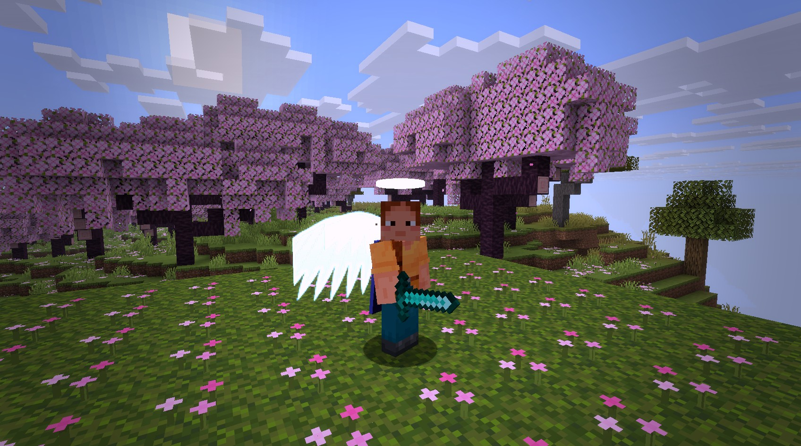
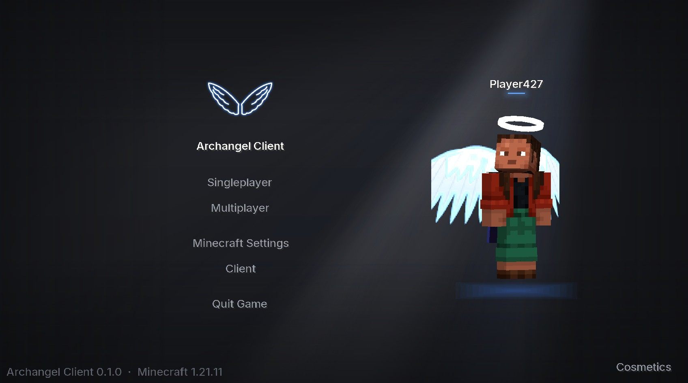
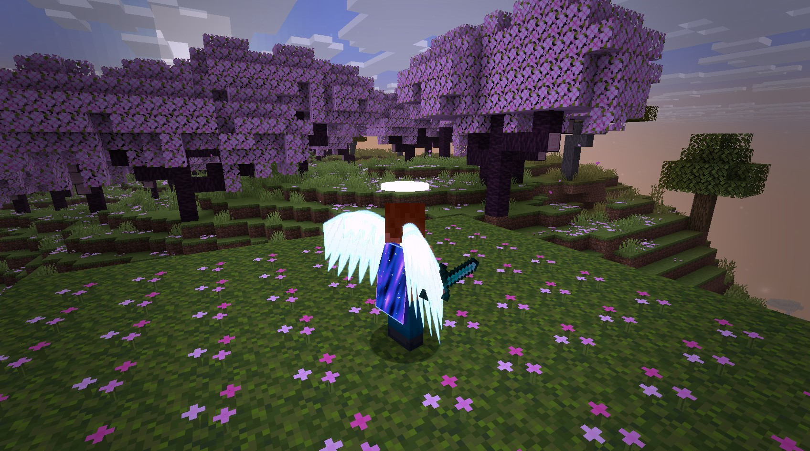
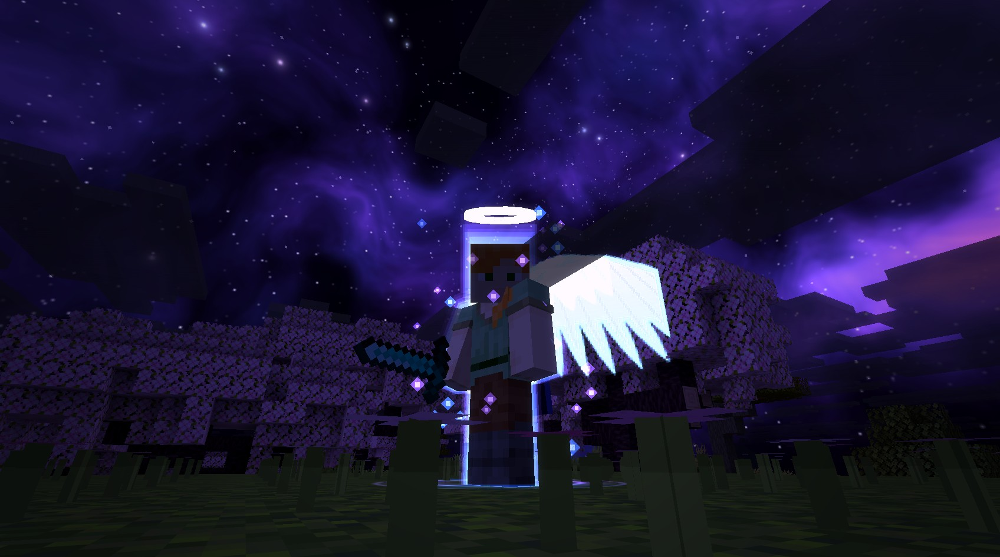
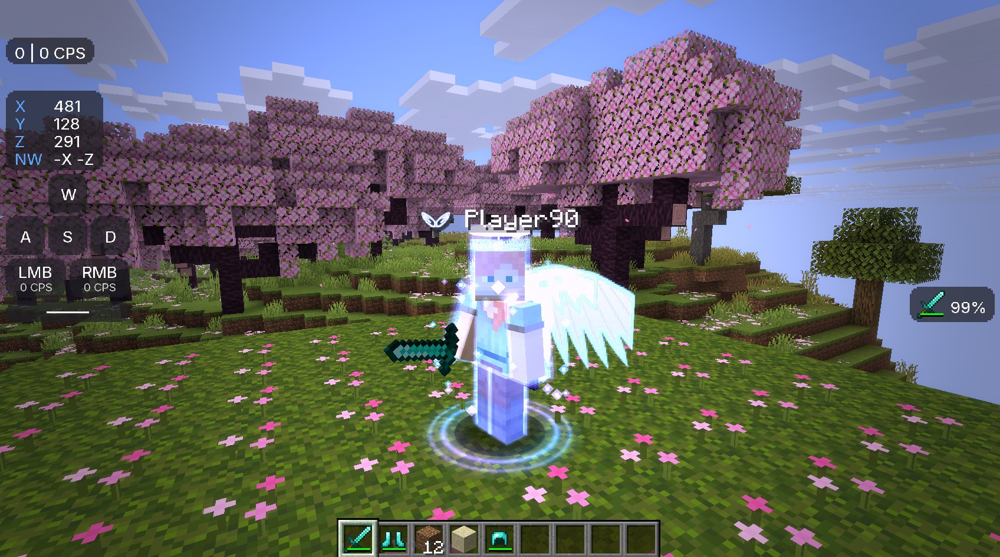
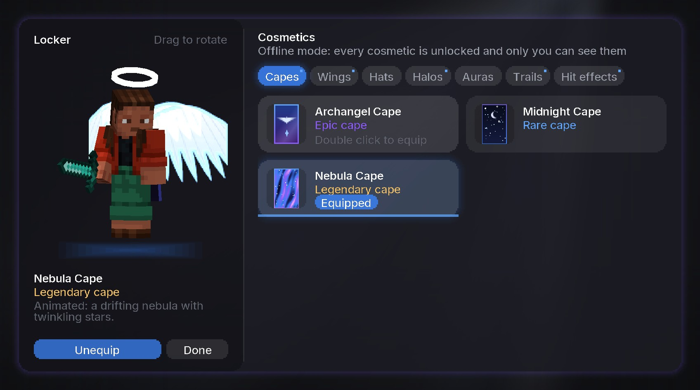
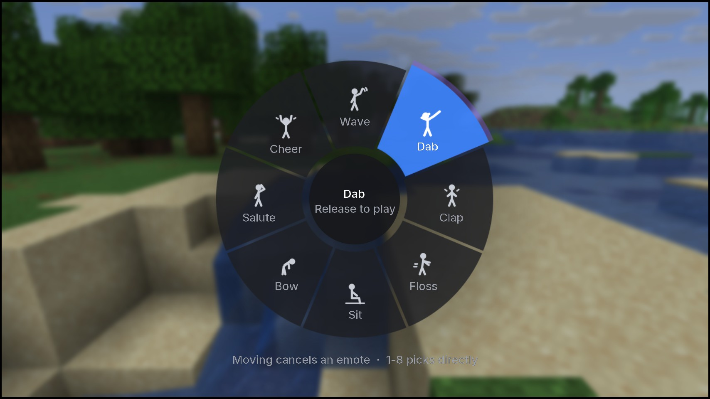
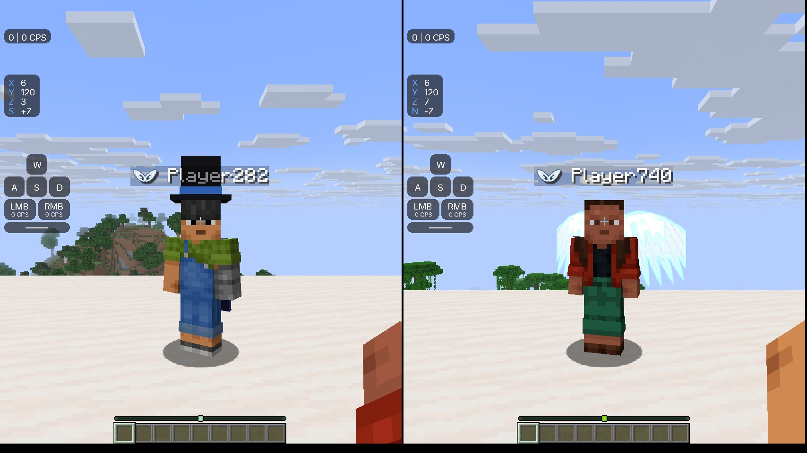

# Archangel Client



A legit PvP and cosmetics client for Minecraft Java 1.21.11, built as a Fabric mod (Mojang
mappings, Java 21). It has custom menus, a HUD with an editor, 1.7-style animations, cosmetics,
emotes, nametag badges, post effects and a nebula sky. A small backend lets Archangel players see
each other.

**No cheats, ever.** Every feature is cosmetic, a UI/HUD feature or a performance feature. There
is no X-ray, ESP, tracers, see-through rendering, killaura, reach, velocity, autoclicker, fly, or
anything else that gives an advantage or reveals hidden information. Cosmetics and effects render
with normal depth testing, so nothing shows through walls. No Mojang assets or code are
redistributed; the client changes the game through mixins against the official mappings.

Progress notes for each milestone, with screenshots, are in [docs/STATUS.md](docs/STATUS.md).

## Gallery

<table>
  <tr>
    <td></td>
    <td></td>
  </tr>
  <tr>
    <td align="center">Title screen with a live 3D preview of your cosmetics</td>
    <td align="center">Seraph wings, halo and the animated Nebula cape at sunrise</td>
  </tr>
  <tr>
    <td></td>
    <td></td>
  </tr>
  <tr>
    <td align="center">The Nebula sky at night, with the Archangel aura</td>
    <td align="center">Aura, nametag badge, and the HUD (CPS, coordinates, keystrokes, armor)</td>
  </tr>
  <tr>
    <td></td>
    <td></td>
  </tr>
  <tr>
    <td align="center">The Locker: try on and equip cosmetics</td>
    <td align="center">Emote wheel (hold B)</td>
  </tr>
  <tr>
    <td colspan="2"></td>
  </tr>
  <tr>
    <td colspan="2" align="center">Two Archangel players seeing each other's cosmetics and wings badges, synced through the backend</td>
  </tr>
</table>

Post effects (bloom, color grading, vignette) are on in these shots. Everything shown is cosmetic.

## Features

- **Menus:** a custom title screen with animated light rays and a 3D preview of you in your
  cosmetics. The preview spins when idle and its head follows the cursor. There's also a client
  settings screen (Right Shift) with search, categories and config profiles.
- **HUD:** FPS, CPS, keystrokes, ping, coordinates, armor, potions, clock, speed, server, memory,
  combo, reach display and target HUD. Open the editor from Client settings → HUD → Edit HUD
  Layout (or bind a key in Controls), then drag to move and scroll to scale, with snapping.
- **Animations:** 1.7 animations, custom swing speed and item position.
- **Cosmetics:** capes (including animated ones), wings, hats, halos, auras, swing trails and hit
  effects, all chosen in the Locker.
- **Emotes:** hold B for the emote wheel. There are 8 Blockbench/Bedrock keyframe emotes, synced
  to other players.
- **Nametags:** an angel-wings badge for Archangel players, display names and colors from the
  backend, plus opacity, shadow, scale and "show own".
- **Visuals:** custom GLSL post effects (motion blur, bloom, color grading, vignette, chromatic
  aberration), a nebula night sky, and a brightness slider within vanilla limits. When Iris is
  installed there's a Shader Packs page.
- **Performance:** FPS Boost (particle level and cap, entity distance, and recommendations for
  Sodium, Entity Culling, ImmediatelyFast and FerriteCore), plus Unfocused FPS.

## Build

You need JDK 21 or newer (tested on 21 and 25). Gradle downloads everything else, including Minecraft, which is never
committed.

```bash
./gradlew build          # mod jar in build/libs/archangel-client-<version>.jar
```

## Run

```bash
./gradlew runClient                                   # dev client, offline account
./gradlew runClient --args="--width 1700 --height 950"
```

The dev client signs in with an offline account, so it can't use Mojang-verified features. See
"Backend" below for testing those locally. On a headless Linux box, run `Xvfb :99 &` first, then
`DISPLAY=:99 ./gradlew runClient`.

To play with it normally, see "Install in your launcher" below.

## Install in your launcher

Archangel is built for **Minecraft 1.21.11** only. Every jar in your mods folder has to be the
1.21.11 build, or Fabric refuses to start with "Incompatible mods found!".

1. Install Java 21 or newer (tested on 21 and 25).
2. Run the [Fabric installer](https://fabricmc.net/use/installer/), pick Minecraft **1.21.11**
   and Loader **0.18.4** or newer. This adds a "fabric-loader-1.21.11" profile to the launcher.
3. Download **Fabric API 0.141.6+1.21.11**:
   [Modrinth page](https://modrinth.com/mod/fabric-api/version/0.141.6+1.21.11) or the
   [direct jar](https://cdn.modrinth.com/data/P7dR8mSH/versions/6qAuTtLR/fabric-api-0.141.6%2B1.21.11.jar).
   The file name must end in `+1.21.11`. The newest build on the Fabric API page is for a newer
   Minecraft version and won't load.
4. Put that jar and the Archangel mod jar in `.minecraft/mods`. Remove any Fabric API jar for
   another Minecraft version. The mod jar is `build/libs/archangel-client-<version>.jar` (not the
   `-sources` jar). The repository's source folder or "Download ZIP" is not a mod; Fabric
   ignores folders, so the game starts as plain Minecraft. To build the jar on Windows, open a
   terminal in the source folder and run `gradlew.bat build`.
5. Start the game with the fabric-loader-1.21.11 profile.

Sodium and Iris are optional and work alongside it; pick their 1.21.11 builds too.

### System properties

Pass these to the game JVM as `-Dname=value`. In dev, add them in `build.gradle` under
`loom { runs { client { vmArg "-Darchangel.devAuth=true" } } }`; otherwise use your launcher's
JVM arguments.

| Property | Default | Use |
| --- | --- | --- |
| `archangel.api` | `http://127.0.0.1:8787` | Backend base URL. The WebSocket uses the same host at `/ws`. |
| `archangel.devAuth` | `false` | If Mojang won't verify the account (dev/offline), sign in with the backend's dev route instead. Needs a backend with `ALLOW_UNVERIFIED=true`. |
| `archangel.allowOfflineUuids` | `false` | Also look up profiles for offline-mode (version 3) UUIDs, for testing on offline servers. |

## Backend

The client works fully offline. Without a backend you see your own cosmetics and nobody else's.
To run the backend locally:

```bash
cd backend
npm install
cp .env.example .env     # set JWT_SECRET; for local testing with dev clients also ALLOW_UNVERIFIED=true
npm run db:deploy
npm run dev              # listens on http://127.0.0.1:8787, which is the client's default
```

Then start the client. In dev, pass `-Darchangel.devAuth=true -Darchangel.allowOfflineUuids=true`
so the offline dev account can sign in. With a real account, sign-in goes through Mojang's
hasJoined check, and your access token only ever goes to Mojang.

For a hosted backend, run it behind HTTPS and start the client with
`-Darchangel.api=https://your.host`. [backend/README.md](backend/README.md) covers the API,
the WebSocket protocol, the limits and deployment.

## Project layout

```
src/main/java/dev/archangelclient/
  ArchangelClient.java   entry point: registers modules, keys, events, backend hooks
  core/                  module, setting, event bus and config/profile system
  gui/                   screens, widgets, Theme (every UI color, size and timing), rendering helpers
  hud/                   HUD elements and the editor's data
  animation/             1.7 animations, swing and item position
  cosmetics/             registry (catalog.json), loadouts, models, render layers, effects
  emotes/                emote registry, keyframe engine (anim/), playback and sync
  nametag/               badges, display names, nametag options
  shader/ sky/ visual/   post effects, nebula sky, brightness, Iris bridge
  performance/           FPS Boost, Unfocused FPS
  net/                   backend REST client, sign-in session, WebSocket, profile cache
  mixin/                 all mixins (listed in archangelclient.mixins.json)
src/main/resources/assets/archangelclient/
  cosmetics/             catalog.json and Blockbench models (models/*.geo.json)
  emotes/                catalog.json and Bedrock animations (animations/*.animation.json)
  shaders/post/          GLSL for the post effects
  textures/ font/ lang/  textures, fonts (Inter, OFL) and translations
tools/                   Python generators for the procedural art (see "Placeholder assets")
backend/                 Node/TypeScript backend
docs/                    PLAN.md, STATUS.md, screenshots
```

## Add a module

A module is a feature with an on/off switch and settings. The settings page is generated from its
settings, and values are saved per config profile automatically.

1. Create a class extending `core.module.Module`, in the package that fits:

   ```java
   public class ZoomHintModule extends Module {
       private final BooleanSetting sound = add(new BooleanSetting("Sound", "Play a click when zooming", true));
       private final NumberSetting size = add(new NumberSetting("Size", "Hint size", 1, 0.5, 2, 0.1).suffix("x"));

       public ZoomHintModule() {
           super("Zoom Hint", "Shows a hint while zooming", Category.VISUALS, false);
           on(TickEvent.class, e -> { /* only subscribed while enabled */ });
       }

       @Override protected void onEnable() {}
       @Override protected void onDisable() {}
   }
   ```

   - The setting types are `BooleanSetting`, `NumberSetting`, `ModeSetting`, `ColorSetting`,
     `KeybindSetting` and `StringSetting` (stored only, with no widget).
   - `.visibleWhen(other::get)` hides a setting that doesn't apply.
   - Override `getNotes()` to show read-only status lines at the top of the page.

2. Register it in `ArchangelClient.onInitializeClient()` with `modules.register(new ZoomHintModule());`.
3. If it needs to change vanilla behavior, add a mixin in `mixin/`, list it in
   `archangelclient.mixins.json`, and have the mixin ask the module whether it's enabled.
4. Put UI colors, sizes and timings in `gui/theme/Theme` rather than inline.

A **HUD element** is a module too. Extend `hud.TextHudElement` (one line of text, like
`hud/element/ClockElement`) or `hud.HudElement` (custom drawing; set `width` and `height` in
`render`). Pass its default anchor position (0 to 1 on each axis) to the constructor. Register it
the same way and it appears in the HUD editor.

The rule still applies: a module may only change what you see or how fast the game runs, never
what you can do or know.

## Add a cosmetic

Cosmetics are data, so most of them need no Java.

1. **Texture.** Put it in `assets/archangelclient/textures/cosmetic/<type>/<name>.png`.
   - Capes use the vanilla cape layout (the existing ones are 256×128, i.e. 4× resolution).
   - Add `<name>_glow.png` for an emissive glow layer.
   - For animated textures, number the frames `<name>_0.png`, `<name>_1.png` and so on.
2. **Model** (wings, hats, halos). Make it in Blockbench as a *Bedrock* model and export
   `models/<model>.geo.json` into `assets/archangelclient/cosmetics/`. Bones named `left_wing` and
   `right_wing` flap. The root can spin and bob, which is how halos move.
3. **Catalog.** Add an entry to `assets/archangelclient/cosmetics/catalog.json`:

   ```json
   {"id": "wings_dawn", "type": "wings", "name": "Dawn Wings", "rarity": "epic",
    "description": "Warm gold feathers.", "model": "seraph_wings", "attach": "body",
    "texture": "wings/dawn", "glow": true, "emissive": true,
    "anim": {"flapSpeed": 0.09, "flapAngle": 9}}
   ```

   - `type` is one of `cape wings hat halo aura trail hit_effect`.
   - `rarity` is one of `common rare epic legendary`.
   - `frames` and `frameTicks` animate the texture.
   - `colors` (`["#RRGGBB", "#RRGGBB"]`) tint auras, trails and hit effects.
   - `attach` is `head` or `body`.
   - `anim` accepts `flapSpeed`, `flapAngle`, `spin` and `bob`.
   - Ids are `[a-z0-9_]`, which is what the backend accepts.

4. Run `./gradlew runClient`, open the Locker, and it's there. Resource reload (F3+T) picks up
   catalog and texture edits without restarting.

## Add an emote

1. **Animate** it in Blockbench on a player-shaped rig and export a Bedrock animation.
   - Bone names are `root`, `head`, `body`, `right_arm`, `left_arm`, `right_leg`, `left_leg`.
     `root` moves the whole player around the feet.
   - Rotations are in degrees. Head keys add to where the player is looking. Positions are in
     pixels, with +y up.
   - `loop` can be `true`, `false` or `"hold_on_last_frame"`. Easing names follow GeckoLib
     (`easeOutBack`, and so on).
2. Save it as `assets/archangelclient/emotes/animations/<id>.animation.json`, with the animation
   named `animation.archangel.<id>`.
3. Add a 64×64 icon at `assets/archangelclient/textures/emote/<id>.png`. Copy an existing
   `.png.mcmeta` next to it for smooth scaling.
4. Add it to `assets/archangelclient/emotes/catalog.json`, whose order is the wheel order:
   `{"id": "spin", "name": "Spin", "description": "A quick twirl"}`.
   - Use `file`, `animation` or `icon` if they differ from the id.
   - Ids are `[a-z0-9_]{1,32}`.
5. The wheel shows up to 8 emotes, and keys 1–8 pick them directly. Emotes stop when you move.

The built-in emotes are generated by `tools/emotes/animations.py`, and their icons by
`tools/emotes/icons.py`. Editing those scripts is the quickest way to tweak them.

## Placeholder assets to replace

All the art in this repo is original and procedurally generated by the scripts in `tools/`. That
makes it safe to ship, but it's placeholder quality. Replace these with designed versions when
you can, keeping the same paths and sizes, or update the catalog:

| Asset | Path (under `src/main/resources/assets/archangelclient/`) | Made by |
| --- | --- | --- |
| Logo (angel wings) | `textures/gui/logo.png` (1024²), `icon.png` (128²), `textures/gui/icon_{16,32,64,128}.png` (window icon) | `tools/gen_logo.py` |
| Nametag badge | `textures/font/badge.png` (wings glyph, 64×40) | `tools/nametag/badge.py` |
| Capes | `textures/cosmetic/cape/{archangel,midnight,nebula_0..7}.png` + `_glow` | `tools/cosmetics/generate.py` |
| Wings | `textures/cosmetic/wings/{seraph,void}.png` + `_glow`, model `cosmetics/models/seraph_wings.geo.json` | same |
| Halos | `textures/cosmetic/halo/{seraph,nebula}.png` + `_glow`, model `halo.geo.json` | same |
| Hats | `textures/cosmetic/hat/{crown,top_hat}.png`, models `crown.geo.json`, `top_hat.geo.json` | same |
| Aura | `textures/cosmetic/aura/swirl.png` | same |
| Emote icons | `textures/emote/*.png` (64², with `.mcmeta`) | `tools/emotes/icons.py` |
| Emote animations | `emotes/animations/*.animation.json` (hand-keyed) | `tools/emotes/animations.py` |
| Nebula sky | `textures/environment/nebula.png` (3×2 cube atlas, 512 px faces) | `tools/sky/nebula.py` |

The UI font is Inter (SIL Open Font License, `font/inter-license.txt`), which is fine to keep.
Swing trails, hit sparks, the emote wheel shapes and the menu light rays are drawn in code, so
they have no files to replace.

## License

All rights reserved (see `fabric.mod.json`). Inter is under the SIL Open Font License.
